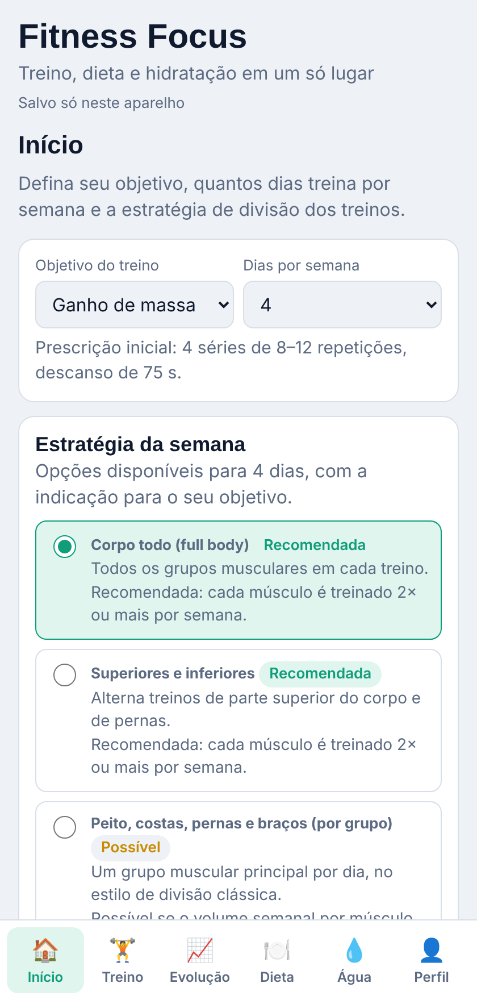
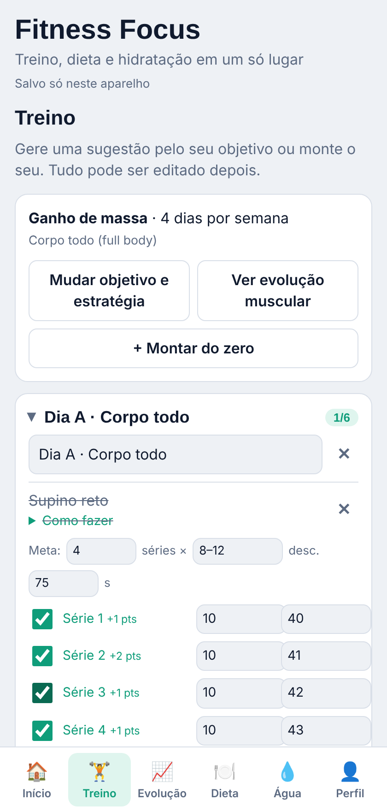
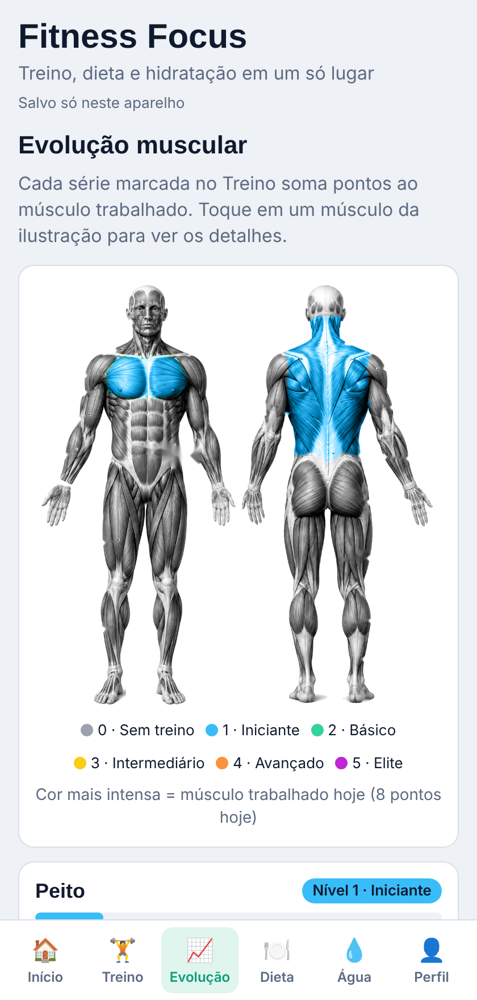
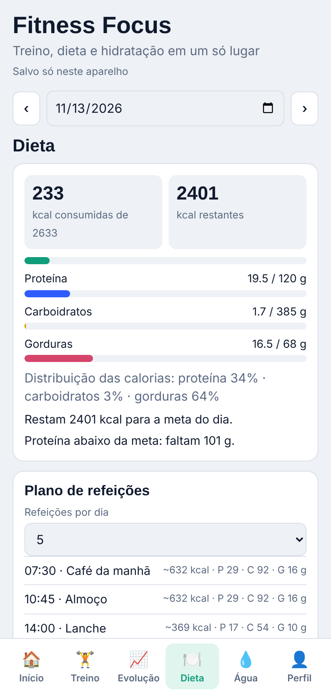
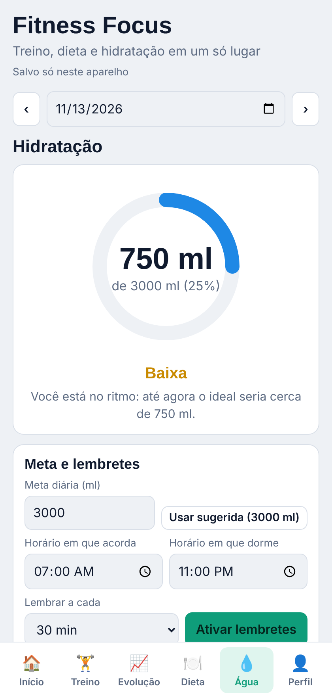

# Fitness Focus

Aplicativo web para **planejar treinos, acompanhar a dieta e controlar a hidratação**, com uma página de evolução muscular que mostra, em uma ilustração anatômica, o nível de cada músculo conforme os treinos são registrados.

Feito com HTML, CSS e JavaScript puros: não precisa de instalação, build nem servidor. Funciona no celular e no computador e já está preparado para virar um app (PWA) nas próximas etapas.

| Início | Treino | Evolução |
|:--:|:--:|:--:|
|  |  |  |

| Dieta | Água |
|:--:|:--:|
|  |  |

> As capturas foram geradas em um ambiente sem acesso à internet, por isso a fonte aparece diferente da usada no app.

## Funcionalidades

### Início: estratégia de treino
- Escolha do **objetivo** (ganho de massa, força, emagrecimento ou resistência) e dos **dias por semana** (2 a 6).
- Lista das **estratégias de divisão** disponíveis para o número de dias escolhido: corpo todo, superiores e inferiores, empurrar/puxar/pernas, híbrido e divisão por grupo muscular.
- Cada estratégia recebe uma etiqueta (**Recomendada**, **Possível** ou **Menos indicada**) com a explicação, baseada na frequência semanal de treino de cada músculo e em revisões científicas (referências na própria página).
- O objetivo define séries, repetições e descanso; emagrecimento e resistência incluem cardio no fim do treino.

### Treino
- Geração automática do plano ou montagem do zero.
- Cada dia é uma **gaveta** que abre e fecha, com contador de exercícios concluídos.
- **Ordem dos dias editável:** botões ▲ e ▼ em cada dia permitem reorganizar a semana depois de montada. Os nomes "Dia A, B, C…" são renumerados automaticamente e as séries já registradas acompanham o dia.
- Para cada exercício: meta sugerida (séries × repetições e descanso, editáveis) e **uma linha por série** com caixa de conclusão, repetições feitas e carga em kg.
- Descrição de **"Como fazer"** nos exercícios da base.
- **Cardio** registra distância em km e tempo em minutos, em vez de carga.
- Exercícios criados pelo usuário também contam para a evolução: o app sugere o grupo muscular pelo nome e permite trocá-lo.

### Evolução muscular
- Ilustração anatômica frontal e posterior em preto e branco; cada grupo muscular é preenchido com a cor do seu nível.
- **10 grupos:** peito, costas e trapézio, ombros, bíceps, tríceps, abdômen, quadríceps, posterior de coxa, glúteos e panturrilhas.
- **6 níveis**, com cores próprias: Sem treino, Iniciante, Básico, Intermediário, Avançado e Elite.
- A pontuação considera a **força demonstrada**, não só as repetições: o app estima a carga máxima para 1 repetição (1RM, fórmula de Epley) e compara com o melhor registro do exercício. Séries com carga muito leve valem 0, e bater um novo recorde rende ponto extra. Em exercícios com peso do corpo, uma fração do peso do usuário entra no cálculo.
- A evolução é guardada separadamente do plano de treino e continua ao trocar de treino.

### Dieta
- Registro de alimentos por refeição (base com alimentos comuns e opção de informar valores próprios).
- Cálculo de **calorias, proteínas, carboidratos e gorduras** do dia, comparados às metas do perfil, com barras de progresso, distribuição percentual e mensagens de análise.
- **Plano de refeições** (3 a 6 por dia) com horários distribuídos entre o despertar e o horário de dormir e divisão sugerida de macros.
- **Cardápio automático do dia:** gera as refeições com alimentos e quantidades em gramas, calculadas a partir das metas do perfil (calorias, proteínas, carboidratos e gorduras), do objetivo (perder gordura, manter ou ganhar massa), da preferência alimentar (sem restrição, vegetariano ou sem lactose), do número de refeições e dos horários de acordar e dormir.
- Botões para gerar outro cardápio, gerar 7 dias de uma vez, **trocar uma refeição** e **registrar a refeição** no diário (com opção de desfazer). Se o perfil mudar, o app avisa que o cardápio ficou desatualizado.
- O cardápio é uma sugestão baseada em valores médios de alimentos e não substitui o acompanhamento de um nutricionista.
- Navegação por data.

### Água
- Medidor circular de hidratação com classificação (de "Muito baixa" a "Meta atingida") e comparação com o ritmo esperado para o horário.
- Registro rápido (150, 250, 350 e 500 ml, ou valor livre), com histórico do dia e opção de desfazer.
- **Meta diária** editável, com sugestão baseada no peso e na atividade.
- **Lembretes** a cada 15, 30, 45 ou 60 minutos, com cálculo de quanto beber em cada aviso para atingir a meta no período em que o usuário está acordado.

### Perfil
- Sexo, idade, peso, altura, nível de atividade, objetivo da dieta, preferência alimentar e horários de acordar e dormir.
- Metas diárias calculadas automaticamente (metabolismo basal pela fórmula de Mifflin-St Jeor, calorias, macros e água).

## Ferramentas e tecnologias

| Área | O que foi usado |
|---|---|
| Interface | HTML5, CSS3 (variáveis, grid, flexbox, tema claro e escuro automático) |
| Lógica | JavaScript (ES6+) sem frameworks nem dependências |
| Gráficos | SVG gerado por código (medidor de água e ilustração anatômica interativa) |
| Armazenamento | `localStorage` do navegador |
| Lembretes | Notification API e avisos dentro da página |
| Tipografia | Google Fonts (Barlow e Barlow Semi Condensed) |
| Tratamento da imagem | Python com OpenCV e Pillow |

## Como foi construído

1. **Requisitos em etapas:** começou como site, com treino, dieta e água, e foi evoluindo por conversa: séries com carga e repetições, lembretes de água, estratégias de treino, evolução muscular e persistência dos dados.
2. **Cálculos nutricionais e de hidratação:** Mifflin-St Jeor para o gasto energético, proteína por kg de peso conforme o objetivo, gordura por kg e carboidratos pelo restante das calorias.
3. **Estratégias de treino:** cada estratégia é uma lista de dias, e cada dia é um modelo que define quantos exercícios de cada grupo muscular entram. A indicação por objetivo usa a frequência semanal de cada músculo e as revisões científicas sobre frequência de treino.
4. **Sistema de níveis:** cada série concluída vira pontos para o grupo muscular do exercício. A comparação com o 1RM estimado evita que repetições com carga muito leve façam o nível subir.
5. **Ilustração anatômica:** a imagem de base passou por limpeza (remoção de textos e linhas), conversão para tons de cinza e fundo transparente. Depois, cada grupo muscular foi mapeado como polígonos SVG sobre a imagem, o que permite colorir e tocar em cada músculo.
6. **Código organizado em três camadas:** `index.html` (estrutura), `css/style.css` (visual) e `js/app.js` (lógica, dados e telas).

O projeto foi desenvolvido com apoio do Claude, da Anthropic.

## Como executar

Não há dependências. Escolha uma das opções:

- **Direto no navegador:** abra o arquivo `index.html`.
- **VS Code:** instale a extensão *Live Server*, clique com o botão direito em `index.html` e escolha *Open with Live Server*.
- **Terminal:** na pasta do projeto, rode `python -m http.server 8000` e acesse `http://localhost:8000`.

### Publicar no GitHub Pages
No repositório, vá em **Settings → Pages**, escolha a branch `main` e a pasta `/ (root)`. O site fica disponível em `https://SEU-USUARIO.github.io/fitness-focus/`.

## Estrutura

```
fitness-focus/
├── index.html          estrutura da página
├── css/style.css       estilos e temas
├── js/app.js           lógica, dados, cálculos e telas
├── assets/anatomia.webp  ilustração anatômica tratada
├── docs/               capturas de tela do README
└── README.md
```

## Observações

- Os dados ficam salvos **no navegador do aparelho**. Limpar os dados do navegador apaga o histórico, e os dados não passam de um aparelho para outro.
- Os lembretes de água só funcionam com a página aberta.
- As metas de calorias, macros e água são estimativas gerais e **não substituem** a orientação de nutricionista, médico ou educador físico.
- A ilustração anatômica deve ter licença que permita o uso no projeto. Confira a origem da imagem antes de publicar em um repositório aberto.

## Próximos passos

- Conta de usuário e sincronização entre aparelhos.
- Base de alimentos maior, com busca.
- Histórico e gráficos de evolução (peso, cargas, calorias, água).
- Cronômetro de descanso e vídeos dos exercícios.
- Instalação como app (PWA) e lembretes em segundo plano.
